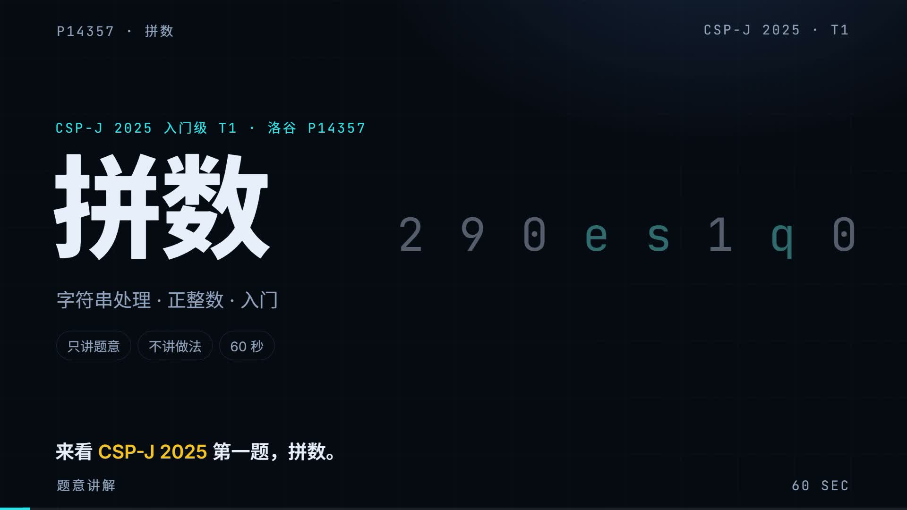

# OJ Video Explainer

把一道编程题做成**两条**视频：只讲题面的**题意讲解**，和逐行执行的**参考答案讲解**。

不是“把题解念一遍”。题意片严格不剧透；答案片必须让你看清数组、变量和代码是怎么一步步变的。

渲染引擎：[HyperFrames](https://github.com/heygen-com/hyperframes)（HTML + GSAP → MP4）。  
不需要剪辑软件，不需要付费 TTS API。




## 它产出什么

| 文件 | 内容 | 默认时长 |
|---|---|---|
| `statement.mp4` | 题面、输入输出、约束、样例；**不含做法** | 60 s |
| `solution.mp4` | 参考代码逐行执行、状态变化、边界与复杂度 | 90 s |
| `poster.jpg` ×2 | 两片封面 | – |
| `shotlist.md` | 两片时间轴与画面说明 | – |
| `params.md` | 分辨率、帧率、配音、音乐、字体 | – |

默认规格：1920×1080 / 30 fps / H.264 / yuv420p；也可改 1080×1920。

## 为什么不是“一条视频讲完”

- **题意片**服务“第一次读题”的人：不能出现排序、贪心、DP、完整代码。
- **答案片**服务“已经想过但没做出来”的人：需要代码高亮、数组变化、错误写法对比。

两条视频的观众状态不同，混在一起会同时得罪两边。

## 特色

- **题意防剧透门禁**：`check_gates.py --statement` 会扫描做法词与代码块。
- **数组/状态可视化**：桶计数、数字飞入、`res` 逐位拼接、溢出对比。
- **本地音频**：edge-tts 中文配音 + numpy 合成稀疏音床，无持续低频。
- **字体子集**：只下载页面用到的汉字，仓库不存字体文件。
- **可复现**：HyperFrames 页面禁止随机数和网络请求，同一工程每次渲染一致。
- **双画幅**：模板默认 16:9，改 `data-width/height` 即可竖版。

## 环境要求

- Node.js ≥ 22
- FFmpeg（full build，含 libx264）
- HyperFrames CLI：`npm i -g hyperframes`
- Python ≥ 3.10
- `pip install edge-tts numpy`

HyperFrames 还需要 Playwright 的 Chromium；首次运行 `npx hyperframes doctor` 会提示。

## 安装

```bash
git clone https://github.com/<your-name>/oj-video-explainer.git
cd oj-video-explainer
pip install edge-tts numpy
```

把整个文件夹放进你的 agent skills 目录，例如：

- Claude Code：`~/.claude/skills/oj-video-explainer`
- Codex：`~/.codex/skills/oj-video-explainer`
- Trae：`~/.trae-cn/skills/oj-video-explainer`

新开一个会话，agent 会读取 `SKILL.md`。

## 快速开始

```bash
# 1. 复制模板
python scripts/init_project.py statement ./work/statement
python scripts/init_project.py solution  ./work/solution

# 2. 编辑 index.html 与 audio/lines.json
#    题意片：不写做法；答案片：写清代码与状态变化

# 3. 生成字体、配音、混音
python scripts/subset_fonts.py ./work/statement/index.html ./work/statement/fonts
python scripts/tts_lines.py ./work/statement --config ./work/statement/audio/lines.json
python scripts/mix_audio.py ./work/statement --config ./work/statement/audio/mix.json

# 4. 检查
python scripts/check_gates.py ./work/statement --statement
npx hyperframes check

# 5. 抽帧审片
npx hyperframes snapshot "--at=2,8,16,24,33,48,62,83"

# 6. 渲染
npx hyperframes render -o out/statement.mp4
```

答案片同理，把 `statement` 换成 `solution`。

## 目录

```text
oj-video-explainer/
├── SKILL.md                 # agent 读取的完整工作流
├── references/
│   ├── problem-parsing.md   # 题面字段与拆题规则
│   ├── statement-video.md   # 题意片结构与防剧透
│   ├── solution-video.md    # 答案片结构与代码走读
│   ├── visual-grammar.md    # 数组/字符串/栈/DP 画法
│   ├── hyperframes-contract.md
│   ├── audio.md             # TTS、混音、避免嗡鸣
│   └── qa-gates.md          # 验收清单
├── scripts/
│   ├── init_project.py
│   ├── tts_lines.py
│   ├── subset_fonts.py
│   ├── mix_audio.py
│   └── check_gates.py
├── templates/
│   ├── statement/index.html # 可渲染的题意片模板（P14357 示例）
│   └── solution/index.html  # 可渲染的答案片模板
└── examples/p14357/
```

模板是“已经跑通的完整工程”，不是空壳。复制后把文案、代码、时间轴替换成当前题目即可。

## 示例：P14357「拼数」

CSP-J 2025 入门级 T1 / 洛谷 P14357。

- 题意 60 秒：字符串、数字、每个位置只能用一次、求最大正整数。
- 答案 90 秒：桶计数 → 数字飞入桶 → 从 9 到 0 拼接 → 为什么用 string。

示例视频见 [Releases](../../releases)。

## 质量门禁

- [ ] 题意片没有做法词、没有完整代码
- [ ] 样例逐字一致
- [ ] 答案片有状态可视化
- [ ] 大数用 `string`
- [ ] `hyperframes check` 通过
- [ ] 无黑帧、无文字溢出
- [ ] 音频峰值 ≤ -1 dBFS，无持续低频

## 许可

- 代码：MIT
- 题目原文：版权归原平台/作者，仓库不附带完整题面
- 字体：Noto Sans SC / Inter / JetBrains Mono，OFL
- 语音：edge-tts（微软在线服务），商用前请确认条款

## 致谢

- [HyperFrames](https://github.com/heygen-com/hyperframes) — HTML → MP4 渲染
- [Lemo-Opuscar](https://github.com/lemomo-ai/lemo-opuscar) — 代码生成视频的工作流启发
- 所有在 OJ 上出题、写题解的人
