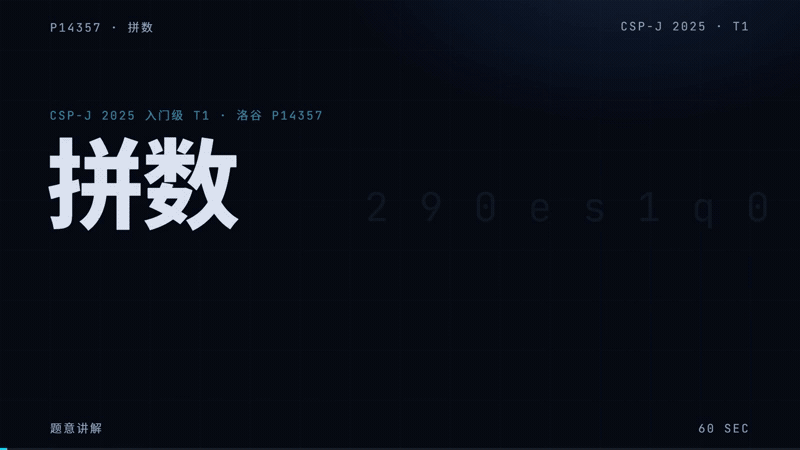

# OJ Video Explainer

**English** | [中文](README.zh-CN.md)

Turn one competitive-programming / OJ problem into **two** explainer videos:

1. **Statement video** — only what the problem says. No solution, no algorithm names.
2. **Solution video** — line-by-line execution of the reference code, with visible array/variable changes.

Rendered with [HyperFrames](https://github.com/heygen-com/hyperframes): HTML + GSAP → MP4.  
No editing timeline, no paid TTS API.

[](LICENSE)




[Watch the 16-second MP4 demo](docs/demo.mp4)

## What you get

| File | Content | Default length |
|---|---|---|
| `statement.mp4` | Problem statement, I/O, constraints, samples; **no solution** | 60 s |
| `solution.mp4` | Reference code walkthrough, state changes, edge cases | 90 s |
| `poster.jpg` ×2 | Covers | – |
| `shotlist.md` | Timelines for both videos | – |
| `params.md` | Resolution, fps, voice, music, fonts | – |

Default format: 1920×1080 / 30 fps / H.264 / yuv420p. Portrait 1080×1920 is supported.

## Why two videos

A viewer who is reading the problem for the first time should not see the algorithm.
A viewer who already tried and failed wants the code, the state changes, and the trap.

One video cannot serve both without spoiling one of them.

## Features

- **No-spoiler gate** — `check_gates.py --statement` scans for algorithm words and code blocks.
- **State visualization** — counting buckets, chips flying from characters into buckets, `res` built digit by digit, overflow comparison.
- **Local audio** — edge-tts Mandarin narration + numpy-synthesized sparse bed. No continuous low-frequency pad.
- **Font subsetting** — only the CJK characters used by the page are downloaded.
- **Deterministic** — no `Math.random()`, no `Date.now()`, no network requests in the composition.
- **Two aspect ratios** — 16:9 by default; 9:16 by changing `data-width` / `data-height`.

## Requirements

- Node.js ≥ 22
- FFmpeg (full build with libx264)
- `npm i -g hyperframes`
- Python ≥ 3.10
- `pip install edge-tts numpy`

Run `npx hyperframes doctor` once to verify the browser and FFmpeg.

## Install as an agent skill

```bash
git clone https://github.com/laoma-coder/oj-video-explainer.git
pip install edge-tts numpy
```

Put the folder in your agent's skills directory:

- Claude Code: `~/.claude/skills/oj-video-explainer`
- Codex: `~/.codex/skills/oj-video-explainer`
- Trae: `~/.trae-cn/skills/oj-video-explainer`

Start a new session. The agent reads `SKILL.md`.

## Quickstart

```bash
# 1. copy a template
python scripts/init_project.py statement ./work/statement
python scripts/init_project.py solution  ./work/solution

# 2. edit index.html and audio/lines.json

# 3. fonts, narration, mix
python scripts/subset_fonts.py ./work/statement/index.html ./work/statement/fonts
python scripts/tts_lines.py ./work/statement --config ./work/statement/audio/lines.json
python scripts/mix_audio.py ./work/statement --config ./work/statement/audio/mix.json

# 4. gates + review frames
python scripts/check_gates.py ./work/statement --statement
npx hyperframes check
npx hyperframes snapshot "--at=2,8,16,24,33,48,62,83"

# 5. render
npx hyperframes render -o out/statement.mp4
```

Repeat with `solution`.

## Repository layout

```text
oj-video-explainer/
├── SKILL.md                 # full agent workflow
├── references/
│   ├── problem-parsing.md
│   ├── statement-video.md
│   ├── solution-video.md
│   ├── visual-grammar.md
│   ├── hyperframes-contract.md
│   ├── audio.md
│   └── qa-gates.md
├── scripts/
│   ├── init_project.py
│   ├── tts_lines.py
│   ├── subset_fonts.py
│   ├── mix_audio.py
│   └── check_gates.py
├── templates/
│   ├── statement/index.html
│   └── solution/index.html
├── examples/p14357/
└── docs/
```

Templates are complete, renderable projects — not empty shells.

## Example: P14357 “拼数”

CSP-J 2025 T1 / Luogu P14357.

- 60 s statement video: string, digits, each position used once, maximum positive integer.
- 90 s solution video: counting buckets → digits fly in → append 9→0 → why `string` instead of `int`.

Demo videos are in [Releases](https://github.com/laoma-coder/oj-video-explainer/releases).

## Quality gates

- [ ] Statement video has zero algorithm words and zero code
- [ ] Samples match the statement character by character
- [ ] Solution video has at least one state visualization
- [ ] Large answers use `string`
- [ ] `hyperframes check` passes
- [ ] No black frames, clipped text, or occluded captions
- [ ] Audio peak ≤ -1 dBFS, no continuous low-frequency hum

## License

- Code: MIT
- Problem statements: belong to their original platforms/authors; this repo does not bundle full statements
- Fonts: Noto Sans SC / Inter / JetBrains Mono (OFL)
- Voice: edge-tts (Microsoft online service); check its terms before commercial use

## Credits

- [HyperFrames](https://github.com/heygen-com/hyperframes) — HTML → MP4 rendering
- [Lemo-Opuscar](https://github.com/lemomo-ai/lemo-opuscar) — inspiration for code-generated video workflows
- Everyone who writes problems and editorials on OJ platforms

---

If this saves you time, a star helps others find it.
