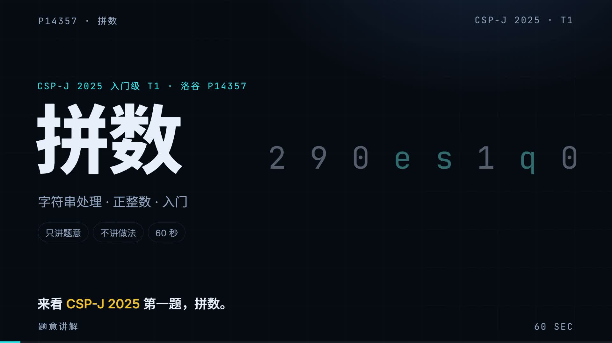
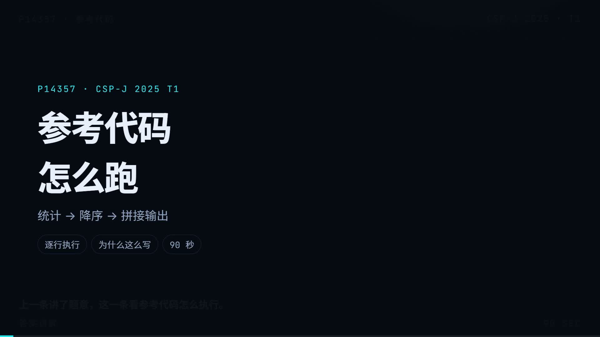

# P14357「拼数」双片示例

CSP-J 2025 入门级 T1 / 洛谷 P14357。

> 下面是我们自己改写的题意摘要，不是原题全文。原题版权归原平台/作者所有。

## 题意摘要

给定一个只含小写字母和数字的字符串 `s`，其中至少有一个 `1`–`9`。
从 `s` 中任选若干个数字字符，按任意顺序拼成一个正整数。
每个位置的字符最多用一次；相同数字出现几次，就能用几次。
求所有能拼出的正整数中的最大值。

输入一行 `s`；输出一个正整数。
`1 ≤ |s| ≤ 10^6`。

样例：

```text
5        → 5
290es1q0 → 92100
```

## 两条视频

| 文件 | 时长 | 内容 |
|---|---|---|
| `statement.mp4` | 60 s | 字符串、数字、每个位置只能用一次、样例 |
| `solution.mp4` | 90 s | 桶计数 → 数字飞入 → 从 9 到 0 拼接 → string 防溢出 |

 

示例视频在 [Releases](../../releases)。

## 答案片的关键画面

1. 左侧 15 行参考代码，当前行高亮
2. 右侧 `arr[0..9]` 桶：大号计数、圆点、`+1`、闪光
3. 字符 → 桶的飞入芯片
4. `res` 逐位出现：`9` → `92` → `921` → `9210` → `92100`
5. `int` vs `string` 的溢出对比
6. 总结：统计 → 降序 → 字符串输出

## 生成参数

- 画幅：1920×1080
- 帧率：30 fps
- 编码：H.264 / yuv420p
- 配音：edge-tts `zh-CN-XiaoxiaoNeural`，+2%
- 字体：Noto Sans SC 子集 + Inter + JetBrains Mono
- 音乐：numpy 合成短拨弦，无持续 pad
- 渲染：HyperFrames

## 复现

```bash
python scripts/init_project.py statement ./work/statement
python scripts/init_project.py solution  ./work/solution
# 按 templates/README.md 替换内容
python scripts/subset_fonts.py ./work/statement/index.html ./work/statement/fonts
python scripts/tts_lines.py ./work/statement --config ./work/statement/audio/lines.json
python scripts/mix_audio.py ./work/statement --config ./work/statement/audio/mix.json
npx hyperframes check
npx hyperframes render -o out/statement.mp4
```
